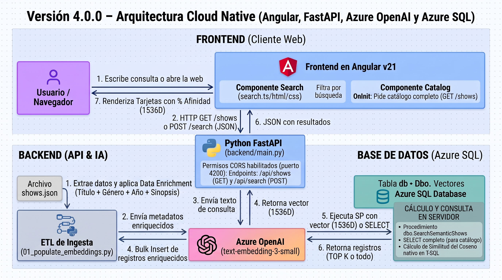
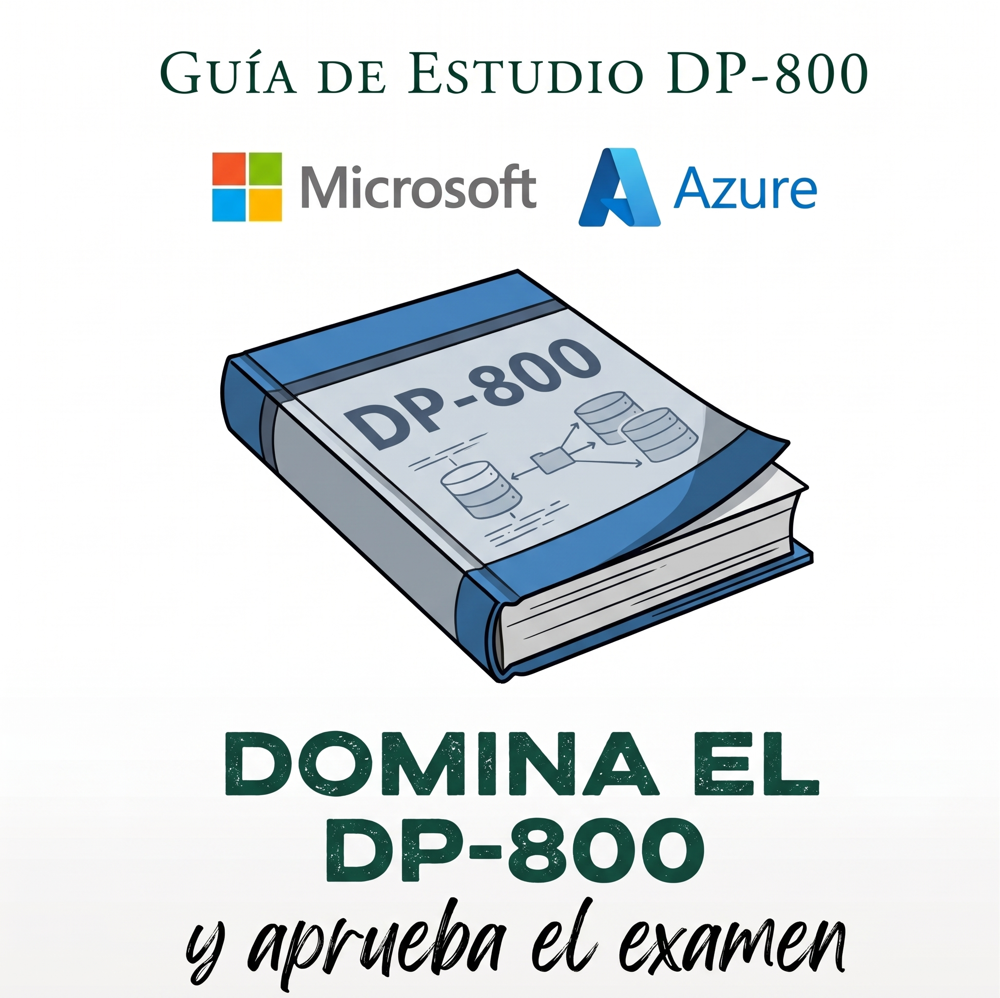

# ¡Hola! Soy Sergio Gutiérrez 👋

### 🚀 Data Engineer & AI Developer | Microsoft Certified (DP-800) | Ex-Team Leader

Soy un **Ingeniero de Datos y Desarrollador de Software** con un background diferente: tras 7 años liderando equipos operativos en el sector bancario corporativo (reconocido como *Mejor Team Leader 2025*), aporto un profundo conocimiento del negocio financiero a mis desarrollos técnicos.

Combino mi visión analítica y de negocio con el diseño de arquitecturas cloud, la automatización de procesos mediante pipelines ETL y la integración de modelos de Inteligencia Artificial para resolver problemas reales.

Actualmente curso el **Máster en Inteligencia Artificial y Data Engineering** en Tajamar Tech (delegado de clase) y acabo de obtener la certificación **Microsoft Certified: SQL AI Developer Associate (DP-800)**.

---

### 🎯 ¿En qué estoy trabajando ahora?
- ☁️ Desplegando arquitecturas cloud en **Azure** y optimizando cargas de trabajo en **Azure SQL**.
- 🔄 Construyendo y orquestando **Pipelines ETL automatizados** con Python y bases de datos relacionales.
- 🧠 Integrando modelos de IA (OpenAI, Ollama) y **Bases de Datos Vectoriales** para búsquedas semánticas y RAG.

---

### 🛠️ Mi Stack Tecnológico

| Capa | Tecnologías |
| :--- | :--- |
| ☁️ **Cloud & Data** | Azure, Azure SQL, PySpark, Databricks, PostgreSQL, MySQL, SQL Server |
| 🧠 **AI & Vectors** | OpenAI API, Ollama (LLMs Locales), ChromaDB, Embeddings, RAG |
| 💻 **Backend & Core** | Python (Pandas, FastAPI, Pytest), Java (Spring Boot), TypeScript |
| ⚙️ **DevOps & Tools** | CI/CD (GitHub Actions), Docker, Git, GitHub, Linux, APIs REST |

---

### 🚀 Proyectos Destacados

**[azureSQLSeries](https://github.com/Sergutierrezm/azure-sql-vector-series-recommender)** | *Azure SQL, OpenAI, FastAPI, Angular*
> Motor de recomendación semántica conectando Azure SQL con modelos de IA. Incluye optimización de cálculos vectoriales pesados en base de datos mediante procedimientos almacenados (Pushdown compute).
 

  

---

---

### 📚 Guías Técnicas y Recursos de Estudio

Documentación práctica, esquemas y apuntes que voy creando mientras preparo certificaciones oficiales de Microsoft Azure, Data Engineering e IA. Todo el material es abierto y descargable.

**[Manual de Estudio Avanzado: Microsoft DP-800 (SQL AI Developer Associate)](https://drive.google.com/drive/folders/1hj8_NZLBr-ZhXKLwKCfie9KiJQvvPVxP?usp=sharing)**
> Guía de 18 páginas sobre diseño, seguridad, rendimiento e integración de IA en soluciones SQL (Azure SQL Database, SQL Server IaaS/PaaS y Microsoft Fabric). Incluye casos de uso reales, ejemplos de configuración y puntos clave para el examen.

 

  

---

### 📫 Conectemos

  
  

